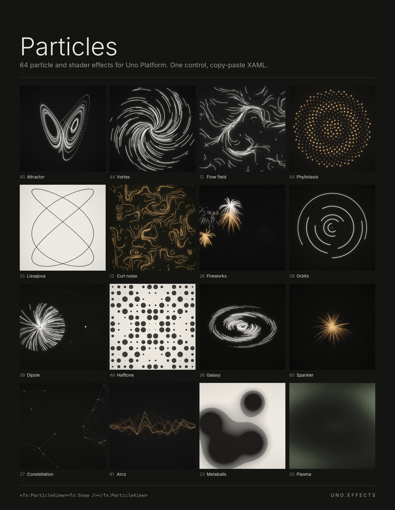

# Uno.Effects — media



Art, screenshots and a walkthrough recording for **Uno.Effects**, a library of 64 particle
and shader effects for Uno Platform behind a single control:

```xml
<fx:ParticleView>
    <fx:Snow />
</fx:ParticleView>
```

Every image is rendered by the library itself. Nothing is painted by hand or generated.

| Path | What |
|---|---|
| [`media/art/`](media/art) | 16 captioned art pieces and the library poster. `clean/` has the same pieces without captions. |
| [`media/screenshots/`](media/screenshots) | The gallery app at 1600×1000. |
| [`media/recording/`](media/recording) | A 45 s real-time walkthrough of the gallery. |
| [`media/tweet.md`](media/tweet.md) | Launch post drafts and which media to attach. |
| [`media/_source/`](media/_source) | Shot lists and scripts to regenerate everything. |
| [`media/art-capture-prompt.md`](media/art-capture-prompt.md) | A reusable prompt for making art captures of any project. |

[`media/README.md`](media/README.md) explains how the art was made and how to regenerate it.

## Status

- The library source (`mtmattei/uno.particles`) is private and the package is not on nuget.org yet.
- No licence has been chosen for these assets yet.
